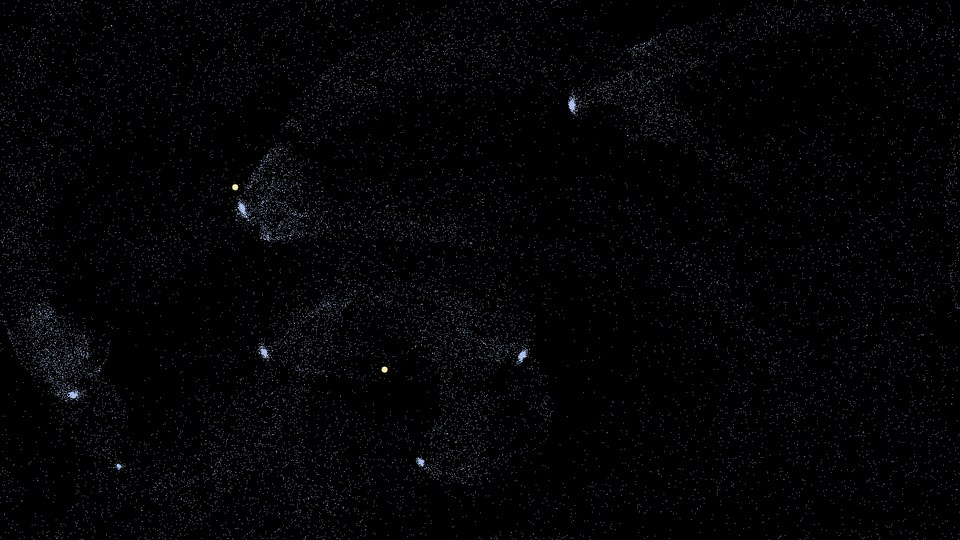
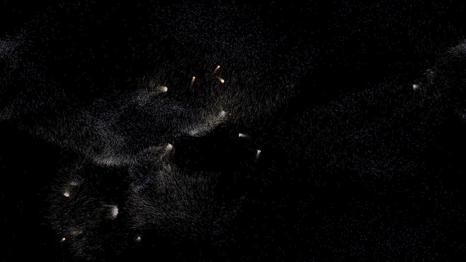
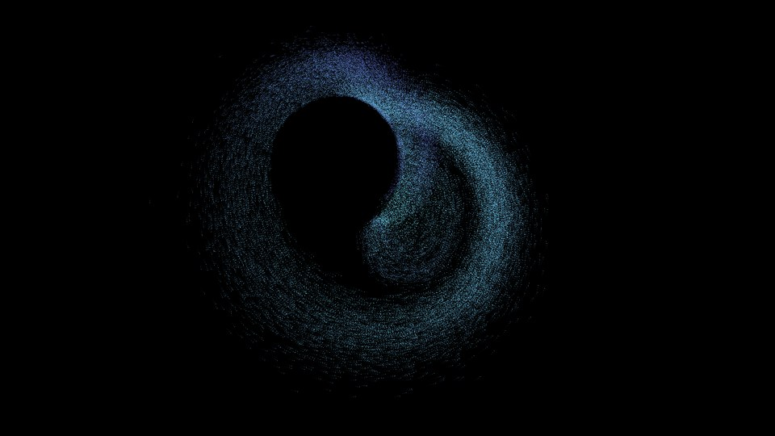
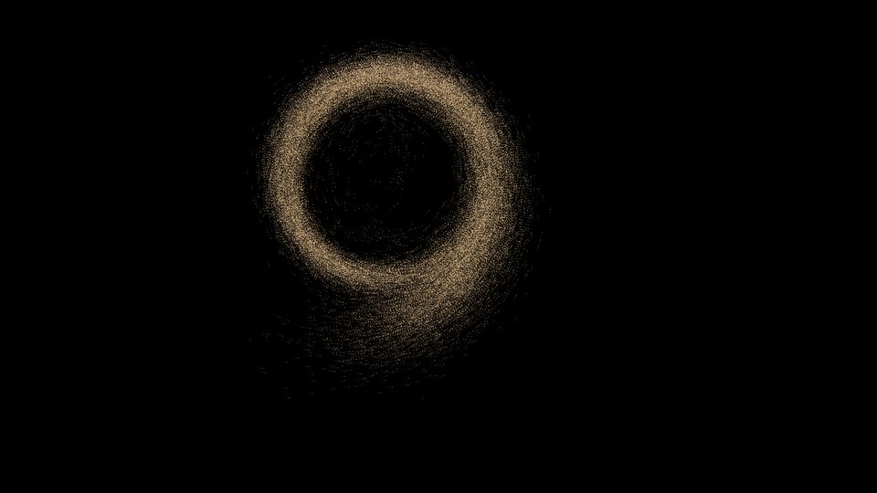
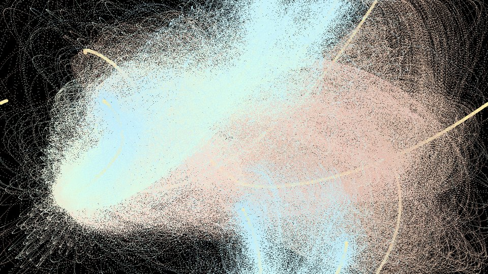

# DesktopUniverse

A particle playground for your desktop. Tens of thousands of grains of sand
orbit, flee and swirl around your cursor and a hierarchy of stars, and it can
run as a live wallpaper behind your desktop icons. Every parameter can be
tuned live from a browser panel and saved as your own preset.

| Solar System | Chain | Whirlpool |
| --- | --- | --- |
|  |  |  |
| **Galaxy** | **Snow Globe** | **Big Bang** (original) |
|  |  |  |

## Run

```bash
python3 -m venv .venv && source .venv/bin/activate
pip install -r requirements.txt

python universe.py                    # full screen; the panel opens in your browser
python universe.py --wallpaper        # live wallpaper under the desktop icons (macOS)
python universe.py galaxy --window 1280x720
python universe.py --list             # all presets
```

The tuning panel lives at <http://127.0.0.1:8765> (local only). Quit from the
panel, with `Esc` / `Q` when the window has focus, or `Ctrl+C` in the terminal.

| Key (window focused) | Action |
| --- | --- |
| `Esc` / `Q` | quit |
| `1`–`9`, `←` `→` | switch preset |
| `R` / `C` / `Space` | restart / clear / pause |
| `F` | fps and preset info |
| `[` `]` | lower / raise the frame cap |

## How a universe is built

A preset is a **stack of layers**, top to bottom. Each layer is a swarm of
identical bodies, and **a layer can only be pulled by the layer directly above
it**. The cursor sits at the very top.

```
mouse                 the top (OOPUniverse.py called it the Absolute)
  star1   (1)         pulled by the mouse
    star2  (3)        pulled by star1
      star3  (9)      pulled by star2
        sand (25000)  pulled by star3
```

Two sources are global and may reach any level: the **mouse** (the original
scripts let it pull both stars and sand) and the **screen centre**, a fixed
anchor that keeps things moving when the cursor is away. Keep upper layers
small: every body of the layer above is a separate source for every body
below, so a pull that would cost more than 600k pairs per frame is skipped
and flagged in the panel.

### Forces (any number per layer)

| Law | What it does |
| --- | --- |
| `classic` | attraction `g / r^n` toward the source (`n = 1` is the original, `2` is Newton); an inner radius with its own gain turns it into a push near the source |
| `oop` | the OOPUniverse.py formula, active only inside a distance window |
| `vortex` | a sideways force, so bodies swirl around the source; add it to `classic` for galaxies |
| `ring` | a spring toward a circle of a given radius; add `vortex` for rings |

Plus, per preset: a swirling **flow field**, constant **wind / gravity**,
**walls** (wrap, bounce with elasticity, respawn, or the original rule),
**trails** from none through fading to permanent, the 120 s **dark cycle**,
and **hold the mouse button to invert** the cursor's pull. Per layer:
friction, **jitter** (temperature, which also stops smooth forces from
collapsing everything into one point), a speed limit, where bodies are born,
how they start moving, and how they look (1×1 to 3×3 pixels or soft round
dots, coloured by the drifting palette, a fixed colour, or their speed).

## Presets

| Group | Presets |
| --- | --- |
| **经典 (original)** | `big_bang`, `less_than_nothing`, `waves`, `raindrops`, `yuanqi_xingkong` 缘起性空, `suibo_zhuliu` 随波逐流, `shennv_sanhua` 神女散花 |
| **新玩法 (new)** | `solar_system`, `chain`, `galaxy`, `saturn`, `smoke`, `snow_globe`, `fountain`, `whirlpool` |
| **我的 (yours)** | whatever you save from the panel |

The originals are 1:1 transcriptions of the scripts in `legacy/`: their
hand-tuned numbers are unchanged, and `tests/test_legacy.py` checks that they
move particles exactly like the original code. Presets you save go to
`presets_user/<name>.json` (one file each, safe to edit or share); saving
under a built-in name overrides it until you delete the copy. The panel also
autosaves your latest experiment every few seconds as **上次的实验**.

## Live wallpaper (macOS)

`--wallpaper` sinks the window one level above the desktop picture, under the
icons, on every Space, and lets clicks pass through. The cursor is read
globally via pyobjc (installed by `requirements.txt` on macOS). The window no
longer takes keyboard input, so quit from the panel or with `Ctrl+C`.

## Project layout

```
universe.py     app: window, keys, wallpaper, panel wiring, autosave
engine.py       simulation: force laws, swarms, the universe
config.py       the data model (Preset / Layer / Pull / Field) and JSON I/O
presets.py      built-in presets and the preset library
panel.py        local web server for the panel
panel.html      the tuning panel
desktop.py      macOS glue: global cursor, wallpaper window
tests/          the legacy-physics test
legacy/         the original one-file scripts
```

Physics is per frame, so the frame cap changes how fast things look; adjust
it with `[` `]` or `--fps`.
