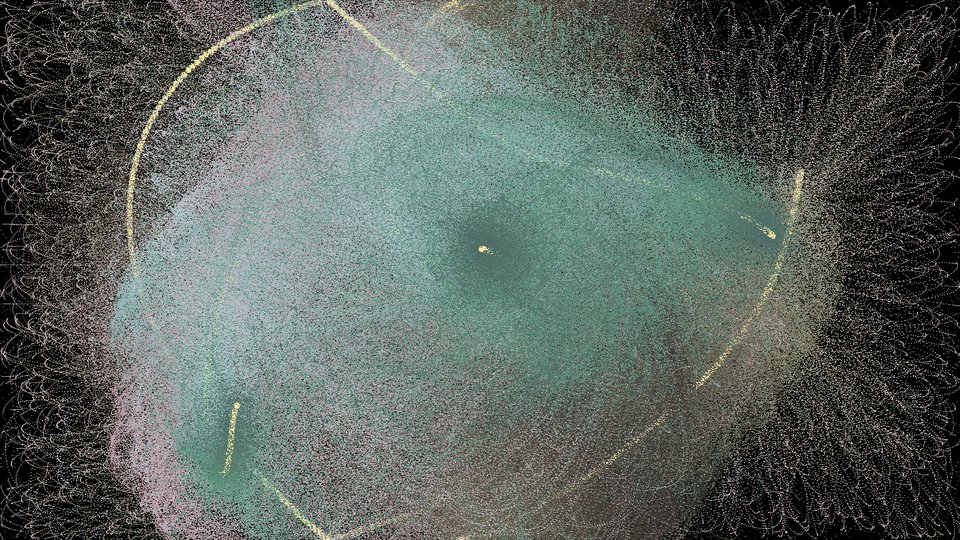
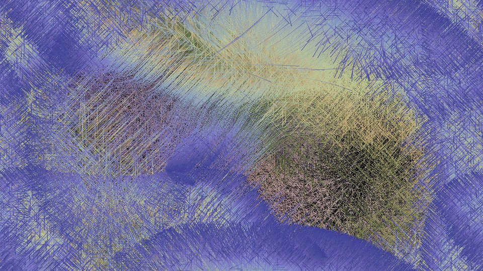

# DesktopUniverse

A full-screen particle playground. Tens of thousands of grains of "sand" fall
toward (or flee from) your cursor and a few wandering stars, leaving slowly
shifting colour trails across the desktop.

| Big Bang | 缘起性空 | 神女散花 |
| --- | --- | --- |
|  |  |  |

## Run

```bash
pip install -r requirements.txt
python universe.py              # default preset
python universe.py waves        # pick one
python universe.py --list       # see all presets
python universe.py --window 1280x720   # windowed instead of borderless full-screen
```

| Key | Action |
| --- | --- |
| `Esc` / `Q` | quit |
| `1`–`7`, `←` `→` | switch preset |
| `R` | restart preset |
| `C` | clear screen (trail presets) |
| `Space` | pause |
| `F` | show fps / preset info |
| `[` `]` | lower / raise the frame cap |

## Presets

| # | Key | Look |
| --- | --- | --- |
| 1 | `big_bang` | sand explodes from the centre, three stars orbit the cursor, trails on |
| 2 | `less_than_nothing` | cursor repels within 500 px and attracts beyond, forming a ring |
| 3 | `waves` | cursor pushes sand away like a wake |
| 4 | `raindrops` | an invisible drop lands somewhere new every frame and splashes sand outward |
| 5 | `yuanqi_xingkong` 缘起性空 | cursor and stars attract, trails on |
| 6 | `suibo_zhuliu` 随波逐流 | cursor repels within 30–200 px, no trails |
| 7 | `shennv_sanhua` 神女散花 | same field as 随波逐流, but with trails |

Every number lives in [`presets.py`](presets.py). To create a new look, copy a
preset and change it, or derive one:

```python
from presets import PRESETS, variant
PRESETS["dense_waves"] = variant("waves", sand_num=40000, friction=0.002)
```

## How it works

* **Objects** – `Absolute` (the cursor), `Stars` and `Sand` are swarms; each frame
  every body first feels its forces (`you_must`) and then moves
  (`therefore_you_can`).
* **Vectorised** – a swarm stores positions and velocities as NumPy arrays, so a
  force is applied to every grain in one operation instead of a Python loop.
* **No sprite files** – grains are written straight into the screen's pixel
  buffer (`pygame.surfarray`); the star is built in memory from a 10×10 alpha mask.
* **Two force laws** – `classic` (*a = g·d/r²*, with an optional inner radius
  that flips or zeroes the pull) and `oop` (*aₓ = g/r²·(dx/r)·|dx|*, active
  inside a distance window).
* **Dark cycle** – presets with `dark="cycle"` fade gravity and colour to zero
  and back every 120 s.

Note: the physics is per frame, so the frame cap changes how fast things look.
Use `[` / `]` or `--fps` to find the pace you like.

## Project layout

```
universe.py     engine, objects and the app (controls, overlay)
presets.py      every tunable number, one Preset per look
docs/           screenshots
legacy/         the original one-file scripts the presets came from
```

| Preset | Original script |
| --- | --- |
| `big_bang` | `legacy/DesktopUniverse.py` |
| `less_than_nothing` | `legacy/less_than_nothing.py` |
| `waves` | `legacy/waves.py` |
| `raindrops` | `legacy/raindrops.py` |
| `yuanqi_xingkong`, `suibo_zhuliu`, `shennv_sanhua` | `legacy/OOPUniverse.py` (its three `MODE`s) |
