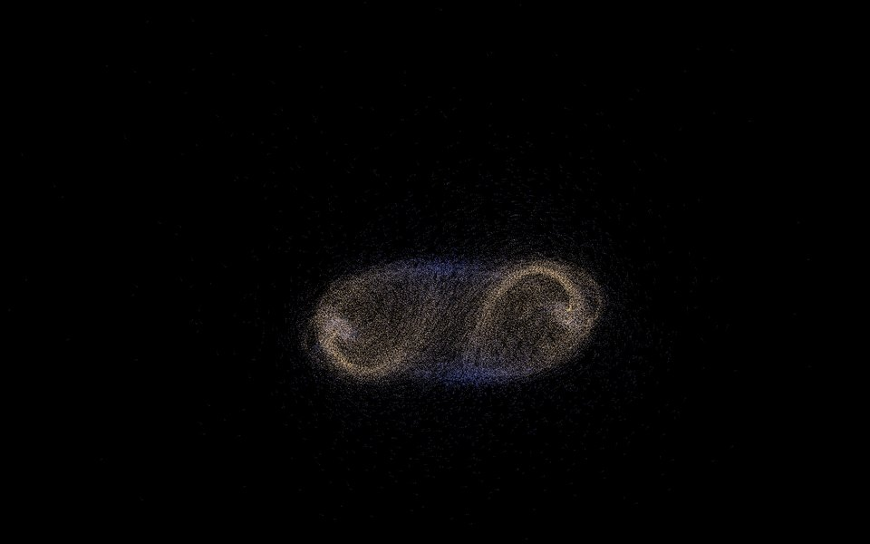
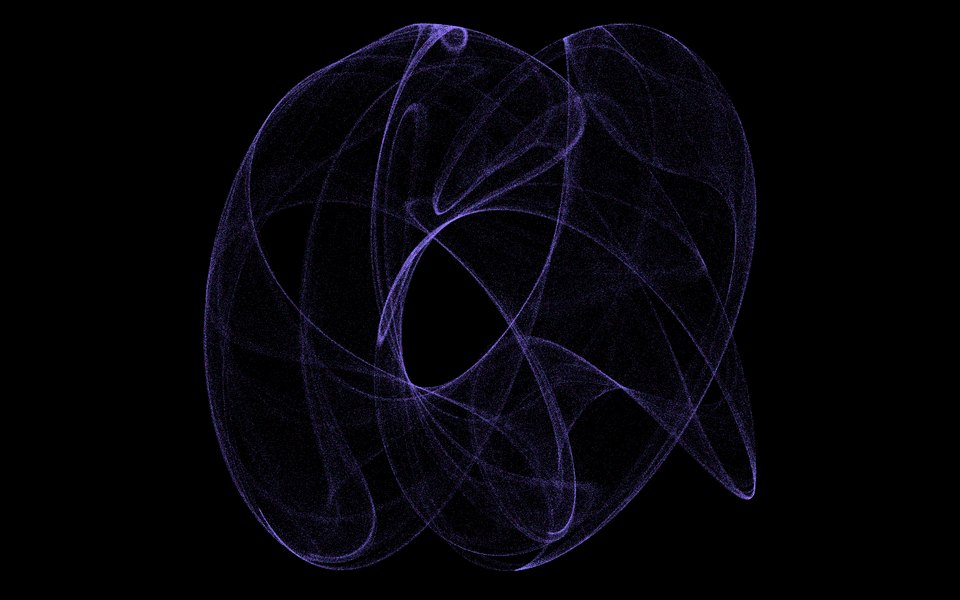
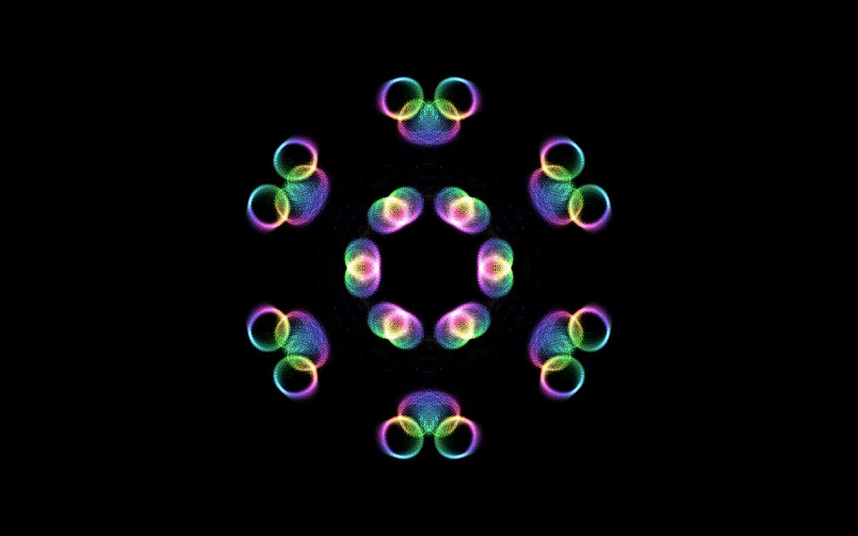
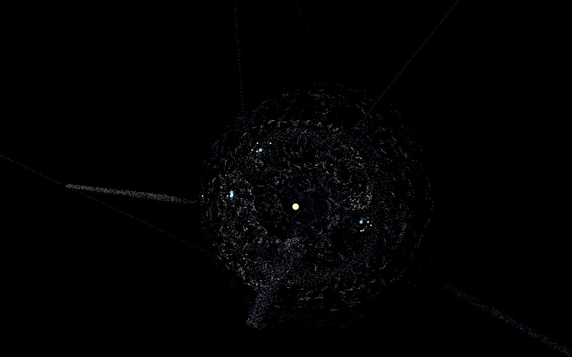
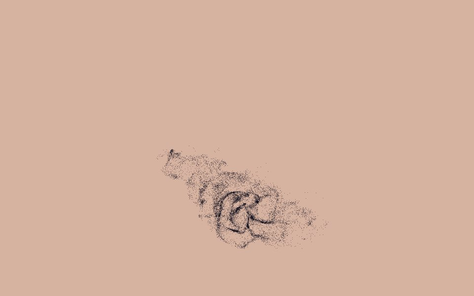
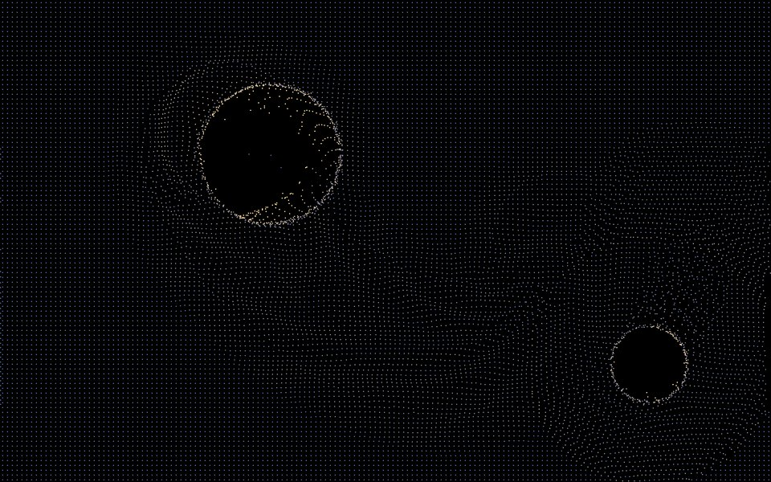
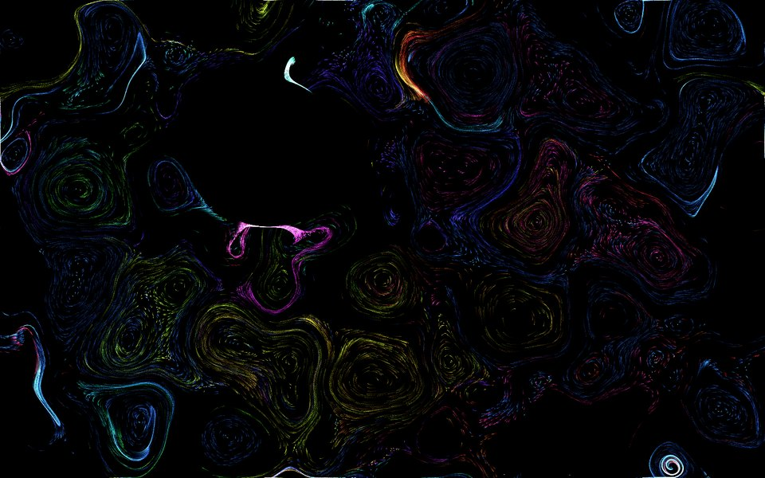
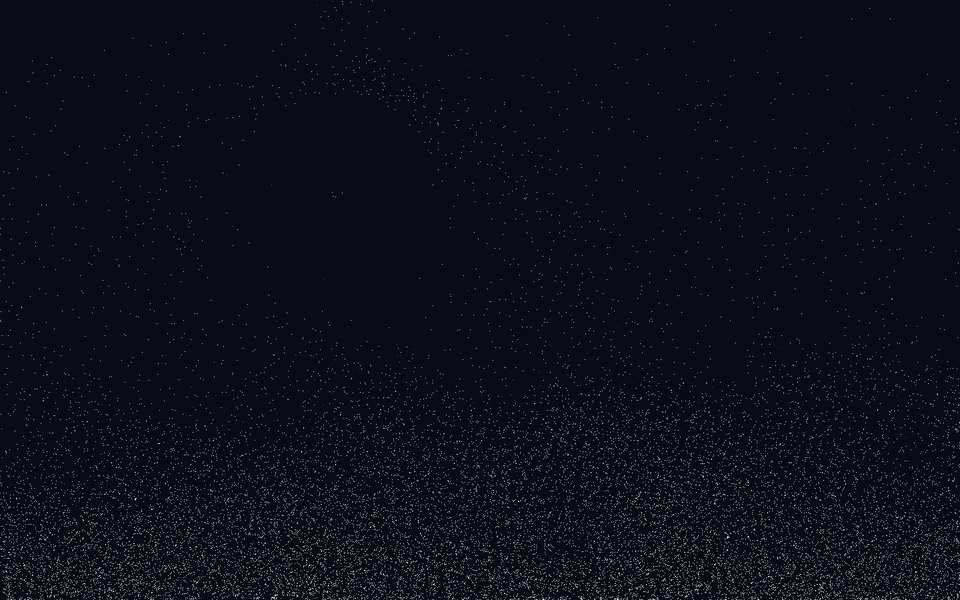
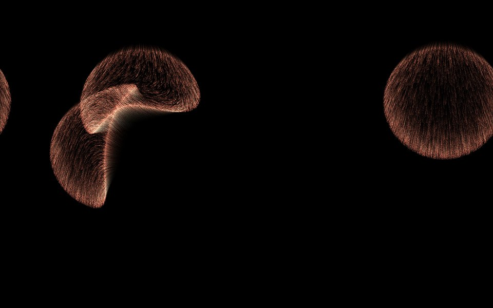

# DesktopUniverse

A living particle wallpaper. Tens of thousands of particles orbit, flock,
flow and burst behind your desktop icons, built from a small set of rules
that can be stacked into layers and tuned live from a browser panel.

| 1 双星系 Binary Galaxy | 2 奇异吸引子 Strange Attractor | 3 曼陀罗 Mandala |
| --- | --- | --- |
|  |  |  |
| **4 星轨 Orrery** | **5 鸟群 Murmuration** | **6 弹性布 Fabric** |
|  |  |  |
| **7 墨流 Ink** | **8 雪景球 Snow Globe** | **9 烟花 Fireworks** |
|  |  |  |

## Run

```bash
python3 -m venv .venv && source .venv/bin/activate
pip install -r requirements.txt

python universe.py               # live wallpaper, on the preset you used last
python universe.py 4             # start on preset 4
python universe.py --window 1280x720
python universe.py --list
```

Control it from:

- **the menu bar ✦**: the nine presets, your own presets, pause, clear, restart, the panel, quit
- **hotkeys**: `⌃⌥1`–`⌃⌥9` presets, `⌃⌥P` pause, `⌃⌥C` clear, `⌃⌥R` restart.
  macOS asks for Accessibility permission for the app that runs Python
  (System Settings → Privacy & Security → Accessibility → your terminal)
- **the panel** at <http://127.0.0.1:8765>: every parameter, live; keys `1`–`9`, `Space`, `C`, `R` work there too
- in `--window` mode, the window itself: `1`–`9`, `←` `→`, `Space`, `C`, `R`, `F` info, `[` `]` frame cap, `Esc`

## How a universe is built

A preset is a **stack of layers**. Each layer is a swarm of identical bodies,
and **a layer is only pulled by the layer directly above it**; the cursor sits
at the very top. The cursor and the screen centre are also available to every
layer as global sources.

```
mouse
  sun      1      moves on its own Lissajous path
    planet 4      orbits the sun
      moon 12     orbits the planets
        dust 30k  born on the moons, fades out: spirograph trails
```

Keep upper layers small: every body above is a separate source for every
body below (pulls costing more than 600k pairs per frame are skipped and
flagged in the panel).

### Mechanisms

| | |
| --- | --- |
| **Forces** | `classic` attraction `strength / r^power` (with an inner radius that can push), `vortex` (sideways: swirl), `ring` (a spring toward a circle), `drag` (match the source's velocity), `wake` (pushed along by a moving source: the cursor stirs) |
| **Pulse** | any force can breathe on a sine; past 1 it swings between pull and push; rings breathe in radius |
| **Neighbourhoods** | `pressure` (flow from crowded to empty: sand piles up; negative clumps) and `align` (match neighbours: flocking), computed on a density grid in O(N) |
| **Home** | a spring back to the birth position; with grid spawning, an elastic sheet |
| **Life** | particles die and are reborn; synced lifetimes plus teleporting parents make fireworks |
| **Emitters** | particles can be born on (or in a ring around) the bodies of the layer above |
| **Motion** | physics, wander, a Lissajous path (no mouse needed), a morphing Clifford / de Jong strange attractor, teleport, fixed |
| **World** | flow field (as wind, or as a current that carries), gravity / wind, walls (wrap, bounce, respawn), friction shape, per-body variety, speed limits, temperature, a breathing light |
| **Paint** | trails from none to permanent, additive glow, kaleidoscope symmetry with mirror, background colour, colour by palette drift, speed, direction, age or rainbow |

Every one of these is a field in `config.py`; the panel builds itself from
the schema at the bottom of that file.

## Presets

The nine built-ins are read-only and live on keys 1–9. Your own presets are
JSON files in `presets_user/`, created from the panel: **新建** (blank),
**保存** (update), **另存为** (create), **重命名**, **删除**. Unsaved edits are
autosaved every few seconds as **上次的实验**, and the app reopens on the
preset you used last.

## Layout

```
universe.py     the app: window / wallpaper, controls, panel wiring, presets CRUD
engine.py       the simulation: forces, neighbourhoods, swarms, painting
config.py       the data model and the panel schema
presets.py      the nine built-ins and the preset library
panel.py/.html  the local tuning panel
desktop.py      macOS: wallpaper window, menu bar, hotkeys, global cursor
tests/          mechanism, preset and library tests (python -m pytest tests)
```

Physics advances per frame, so the frame cap sets the pace (`[` `]`, `--fps`).
The project started as a single pygame script; its history is in git.
