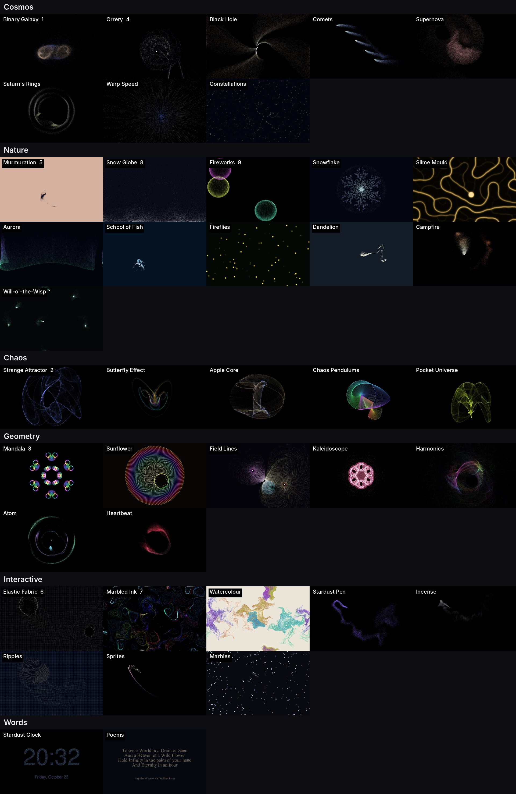

# DesktopUniverse

**▶ Play it in the browser: <https://alexw6385.github.io/DesktopUniverse/>** (the same engine and presets,
ported to JavaScript and WebGL)

A living particle wallpaper. Tens of thousands of particles orbit, flock,
flow and burst behind your desktop icons, built from a small set of rules
that can be stacked into layers and tuned live from a browser panel.



41 built-in universes in six groups (Cosmos · Nature · Chaos · Geometry · Interactive · Words), picked
from the menu bar; nine of them also sit on hotkeys 1–9. Every one is a few hundred
bytes of parameters over the same engine, and the panel lets you make your own.

## Run

```bash
python3 -m venv .venv && source .venv/bin/activate
pip install -r requirements.txt

python universe.py               # live wallpaper, on the preset you used last
python universe.py 4             # start on preset 4
python universe.py --window 1280x720
python universe.py --rotate 15     # next preset every 15 minutes
python universe.py --autostart on  # start the wallpaper at login (macOS LaunchAgent)
python universe.py --list
```

Control it without leaving the wallpaper (the panel is only for editing and never opens by itself):

- **the menu bar ✦**: every preset by group plus your own, next / previous, **Rotate presets**
  (every 5 / 15 / 30 / 60 minutes, in order or in **Random order**), pause, **Pause when covered by
  windows** (the simulation sleeps while windows cover the desktop or you are on another Space, so it
  costs nothing while you work), clear, restart, **Start at login**, the panel, quit
- **hotkeys**: `⌃⌥1`–`⌃⌥9` presets, `⌃⌥←` / `⌃⌥→` previous / next, `⌃⌥P` pause, `⌃⌥C` clear,
  `⌃⌥R` restart. macOS asks for Accessibility permission for the app that runs Python
  (System Settings → Privacy & Security → Accessibility → your terminal)
- **the panel** at <http://127.0.0.1:8765>: every parameter, live; keys `1`–`9`, `Space`, `C`, `R` work there too
- in `--window` mode, the window itself: `1`–`9`, `←` `→`, `Space`, `C`, `R`, `F` info, `[` `]` frame cap, `Esc`

## How a universe is built

A preset is a **stack of layers**. Each layer is a swarm of identical bodies,
and **a layer is only pulled by the layer directly above it**; the cursor sits
at the very top. The cursor and the screen centre are also available to every
layer as global sources.

```
mouse
  sun      1      moves on its own Lissajous path
    planet 4      orbits the sun
      moon 12     orbits the planets
        dust 30k  born on the moons, fades out: spirograph trails
```

Keep upper layers small: every body above is a separate source for every
body below (pulls costing more than 600k pairs per frame are skipped and
flagged in the panel).

### Mechanisms

| | |
| --- | --- |
| **Forces** | `classic` attraction `strength / r^power` (with an inner radius that can push), `vortex` (sideways: swirl), `ring` (a spring toward a circle), `drag` (match the source's velocity), `wake` (pushed along by a moving source: the cursor stirs), `startle` (pushed away in proportion to how fast the source moves: a still cursor is ignored, a sudden swipe scatters everything); any force can **absorb** (swallow what comes too close: an event horizon) |
| **Pulse** | any force can breathe on a sine; past 1 it swings between pull and push; rings breathe in radius |
| **Neighbourhoods** | `pressure` (flow from crowded to empty: sand piles up; negative clumps) and `align` (match neighbours: flocking), computed on a density grid in O(N) |
| **Home** | a spring back to the birth position; with grid spawning, an elastic sheet; on a path, an elastic curve the cursor can push |
| **Life** | particles die and are reborn; synced lifetimes plus teleporting parents make fireworks |
| **Births** | on (or in a ring around) the bodies of the layer above, at or around the cursor, on the pixels of a line of text; a click can burst particles out at the cursor; bursts can be a 3D shell seen head-on |
| **Text** | bodies spring to the glyphs of a few lines of text; pages separated by `\|` take turns (on a timer, and on a click if you like; text layers with the same timing turn together, so a poem keeps its title), `{time}` `{date}` `{weekday}` are filled in live, so a swarm can be a clock or a poem |
| **Motion** | physics, wander, paths (Lissajous, rose, Spirograph, sunflower: Vogel's golden-angle spiral), a morphing Clifford / de Jong attractor, **3D attractors** (Lorenz, Aizawa, Thomas, Halvorsen, Rössler) in perspective that the cursor turns, **double pendulums**, **crystal growth** (diffusion-limited aggregation with noise reduction, grown in one wedge and mirrored into a snowflake), **slime mould** (Physarum agents that smell a scent map, turn toward it and lay more), teleport, fixed |
| **World** | flow field (as wind, or as a current that carries), gravity / wind (fixed, or tilting toward the cursor), walls (wrap, bounce, respawn), friction shape, linear damping (1 = no momentum: bodies walk down field lines), per-body variety, speed limits, temperature, a breathing light |
| **Paint** | trails from none to minutes long (fading fully to the background, dark or paper), additive glow, soft glowing dots, per-body twinkle, lines between neighbours (all in range or the nearest few, everywhere or only around the cursor), kaleidoscope symmetry with mirror, colour by palette drift, speed, direction, age, rainbow, the moment of birth or position in the layer |

Every one of these is a field in `config.py`; the panel builds itself from
the schema at the bottom of that file.

## Presets

| Group | Presets |
| --- | --- |
| Cosmos | Binary Galaxy ¹ · Orrery ⁴ · Black Hole · Comets · Supernova · Saturn's Rings · Warp Speed · Constellations |
| Nature | Murmuration ⁵ · Snow Globe ⁸ · Fireworks ⁹ · Snowflake · Slime Mould · Aurora · School of Fish · Fireflies · Dandelion · Campfire · Will-o'-the-Wisp |
| Chaos | Strange Attractor ² · Butterfly Effect · Apple Core · Chaos Pendulums · Pocket Universe |
| Geometry | Mandala ³ · Sunflower · Field Lines · Kaleidoscope · Harmonics · Atom · Heartbeat |
| Interactive | Elastic Fabric ⁶ · Marbled Ink ⁷ · Watercolour · Stardust Pen · Incense · Ripples · Sprites · Marbles |
| Words | Stardust Clock · Poems (public-domain verse; click for the next one) |

Superscripts are the hotkey slots. Each preset's description (what it is
made of, and what the mouse does to it) shows in the panel. The built-ins are
read-only; your own presets are JSON files in `presets_user/`, created from
the panel: **New** (blank), **Save** (update), **Save as** (create), **Rename**,
**Delete**. Unsaved edits are autosaved every few seconds as **Last experiment**, and
the app reopens on the preset you used last.

## Web version

`web/` is the same universe in a browser: the engine ported to JavaScript (`web/js/engine.js`), drawn
with WebGL (`web/js/render.js`), with a gallery of every preset, autoplay and the same tuning panel
(`web/js/panel.js`, built from the same schema). Presets you make there are kept in the browser, and
**Export** downloads them as JSON that the desktop app reads from `presets_user/` (and **Import** reads
those files back).

The presets themselves are not copied by hand: `python web/export.py` writes them, the groups, the
hotkey slots and the panel schema from `presets.py` and `config.py` into `web/data.js` (and makes the
gallery thumbnails from `docs/`). On every push to `main`, a GitHub Action runs the export and
publishes `web/` to GitHub Pages. To try it locally (opening `web/index.html` directly works too):

```bash
python web/export.py
python -m http.server -d web 8000     # then open http://localhost:8000
```

## Layout

```
universe.py     the app: window / wallpaper, controls, panel wiring, presets CRUD
engine.py       the simulation: forces, neighbourhoods, swarms, painting
config.py       the data model and the panel schema
presets.py      the built-ins and the preset library
panel.py/.html  the local tuning panel
desktop.py      macOS: wallpaper window, menu bar, hotkeys, global cursor
web/            the browser version (GitHub Pages)
tests/          forces, mechanisms, every preset, the library (python -m pytest tests)
```

Physics advances per frame, so the frame cap sets the pace (`[` `]`, `--fps`).
The project started as a single pygame script; its history is in git.
